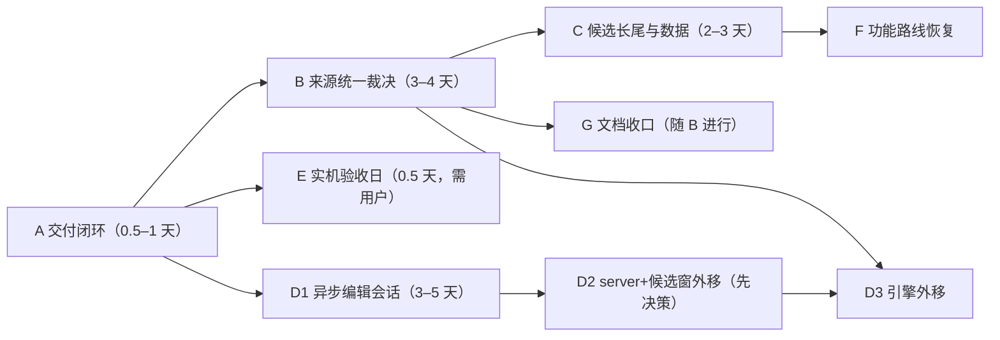

# 泰深输入法 — 设计稿审计 + 问题梳理 + 解决方案（2026-11-20）

> 输入：`IME-用户反馈闭环统计-2026-11-20.md`、`IME-现状汇总-2026-11-20.md`
> 核对范围：`candidate-ranking/DESIGN.md`、`engine-process-isolation/DESIGN.md`、`ARCHITECT-V4.md`、`correction/SPEC.md`、`BUG_2026-11-16.md`、两份 HANDOFF、`engine/src/lib.rs` 的 `query_all` 排序链、安装脚本、本机部署目录；用 HEAD 版 `probe_candidates` 实跑了一遍（窗宽 5）。
> 本次**只做审计和方案，没有改任何代码或文档**。

---

## 〇、结论先行：五个核心点

| # | 核心点 | 一句话 | 覆盖的问题 |
|---|---|---|---|
| **K1** | **交付断层** | 本机 4 个二进制分属 3 个版本；安装包里的 ACL 授权和「容器内不支持」的决定互相矛盾；「修完」的标准里不含部署和用户复测 | 反馈 #1–#10 全部、模式一、§2.4 |
| **K2** | **排序没有统一裁决** | 候选位置由约 15 处 `insert/splice` 加一个 6 维排序键共同决定。「是否可信」只看 `is_common_word`（共 14 处）——一张 2733 条的人工表，里面有「断法」，却没有「算法」「候选」 | #2 #5 #6 #8 #9、模式二/三、suanfa / houxuan / sj / nsdd / xian 窗宽 / 英文过多 |
| **K3** | **设计稿彼此打架、也和代码对不上** | 现状汇总引用的几条「事实」本身已经过时（容器根因「未做」其实做了；阶段 2 的前置早被 V4 作废），V4 第 1 步（异步编辑会话）在汇总里完全没出现 | §1.1 §1.2 §3、#4 |
| **K4** | **验收口径不统一** | 基线有 3 个数；exam 默认窗宽和用户实际用的 5 位窗不一致；exam 用例混着「引擎问题」和「词库缺词」 | §〇、§2.1 FAIL 清单 |
| **K5** | **V4 进程外方案有 4 个设计缺口** | 容器里拉不起普通权限的 server；管道和 DLL 文件都没有 AppContainer 访问规则；z-band 遮挡要靠 uiAccess（需要签名 + 装到 Program Files）；回退到进程内路径会在容器里重新卡死 | §1.1、§2.5、#4 |

> [!IMPORTANT]
> 执行顺序：**K1（今天就能做）→ K2（一轮专项）→ K3/K4（跟着 K2 一起收口）→ K5（V4 第 1 步不受影响，第 2 步要先做决策）**。

---

## 一、设计稿审计

### 1.1 `candidate-ranking/DESIGN.md`（自称「唯一总纲」，现状汇总标为「✅ 一致」）

**审计结论：不一致，至少 8 处。**

| # | 文档写的 | 代码实际（`lib.rs`） | 影响 |
|---|---|---|---|
| D1 | §5.2 排序键是**五维** `(group, exact_len_rank, user_rank, common_rank, combo_like)` | **六维**，最前面多一维 `fuzzy_rank`（L3230） | 读文档推不出实际顺序 |
| D2 | §5.2「纠错来源整体退到 **group 2**」 | 退到 **group 3**（L3184） | 同上 |
| D3 | §5.1 阶段表 12 步：第 11 步「单字母单字优先」在降权**之后** | 已移到降权**之前**（L2966，`4abb998`）；另外表里漏了 `apply_completion_boost`、`apply_fuzzy_demote`、末尾的 Datetime `splice(0)`、过滤后 Phrase 的重新插入 | 阶段表少了 4 步，顺序也错了 1 处 |
| D4 | §2.1「P5 联想兜底只在**候选不足一页**或输入质量差时触发」 | 邻键纠错的门槛是 `< page_size * max_pages`（40 条，L2568），实际上几乎每次都触发；插入纠错 / 拆组同理 | 「兜底」名不副实，这正是纠错抢位的入口 |
| D5 | §4.2「邻键纠错：**仅完整拼音**」 | 0.1.50 之后不再要求完整拼音（L2558 注释），改成「不像英文单词就跑」 | 同上 |
| D6 | §5.2「纠错额外规则：候选里已有常用词时退组」 | 实际判据是 `exact_has_common`，而且**只有这一条**。精确命中词不在常用表时（算法），纠错会被 `insert(0)` 插到最前（L2621–2636），排序键里又是平手，稳定排序把它留在第 1 位 | **suanfa 的直接根因**（见 §三 K2） |
| D7 | §10.2 第 5 条「候选结构体是 `{text, source}`，没有 score」 | 代码和这句一致。但另两份文档把阶段 2 / V4 第 3 步的前置写成「`Vec<String>` → 结构体」，**这一步其实早就做了** | 前置条件写得比实际重，阻塞判断错了 |
| D8 | §10.3 编号重复（两个「4.」）；§3.3 写「页大小默认 5」，但补全插位、隔音提升都按 `page_size` 动态算，排序结果随窗宽变化，文档没声明这一点 | — | `xian` 宽窗 / 窄窗顺序不同，就是这条没被当成设计约束 |

### 1.2 `correction/SPEC.md`

| # | 问题 |
|---|---|
| C1 | 文档约定「变体排在精确命中之后（不干扰正确输入）」「仅在无精确候选或候选不足时生成」。代码在 0.1.50 改成「精确段没有常用词就插到最前」，**约定被单方面推翻，SPEC 没更新** |
| C2 | §二 第 52–61 行留着一段推理草稿（「logn 想打 long，是 g 误触 n？不——…」），不是规格内容 |
| C3 | 「不做：前后字互换」和第 66 行「相邻交换」自相矛盾；遗留-01 要的「换位 + 漏字」组合编辑也没有写进规格 |

### 1.3 `engine-process-isolation/DESIGN.md`（现状汇总标为「✅ 内容一致」）

| # | 问题 | 证据 |
|---|---|---|
| E1 | **§6.5 停留在 11-17 13:31**，写「三段未测量，不应再基于推测改动」。但 14:09 的 `75cec82` 已经按 `ActivateEx` 分段计时定位并修掉 43 秒假死，HANDOFF-11-17 又定位了另外两条（D2D 建窗阻塞、`TF_ES_SYNC` 上屏卡 22 秒） | `git show 75cec82`、HANDOFF-11-17 §二 |
| E2 | 文件头写「阶段 1 已实现并实测」，验收第 1 项 ✅。实际处置是**撤掉 ACL**，容器里泰深不可用 | §6.5 |
| E3 | §3「阶段 2 前置：第二次崩溃样本 + 候选结构体化」——ARCHITECT-V4 §14 已声明「阶段 1/2 划分作废，改按四步」，本文没标作废 | V4 §14 |
| E4 | §5.3 的 `FrameUpdate` 写了「**云联想**就绪后主动推送」，和「明确不做：云候选」冲突 | §5.3 |
| E5 | §5.6「server 起不来 → 回退进程内路径」：在容器里回退进程内路径，正好重现 D2D / 同步会话的卡死 | 与 §6.5 矛盾 |
| E6 | `docs/index.md` 第 96 行正在改（工作区未提交），改后写「前置为候选结构体化」，延续了 D7 的错误 | `git diff docs/index.md` |

### 1.4 `ARCHITECT-V4.md`

大方向没问题（DLL 只留收键 / 写文档 / 量光标），但缺 4 块落地必需的设计：

| # | 缺口 | 为什么致命 |
|---|---|---|
| V1 | **容器内怎么拉起 server**。§7 写「DLL 拉起来」 | AppContainer 进程 `CreateProcess` 出来的子进程会继承容器令牌，server 也变成容器进程，读不到词库，等于没解决问题。server 必须由普通进程拉起（登录自启 / 普通宿主里的 DLL 拉起），容器里的 DLL **只连不拉** |
| V2 | **管道和 DLL 文件的访问规则** | 容器进程要连管道，管道 DACL 得包含 `S-1-15-2-1`（必要时加低完整性标签）；容器能加载 TSF DLL，DLL 文件本身也要有 `S-1-15-2-1:(RX)`。现在白名单只授权了词库文件，**DLL 没有**（本机 `icacls` 已核实） |
| V3 | **z-band 遮挡** | 第 2 步验收要求「容器内候选窗可见」。任务栏搜索这类高 z-band 宿主，没有 uiAccess 时 server 的窗口可能照样被盖住。uiAccess 要求代码签名 + 装在 Program Files，而现在装在 `%LOCALAPPDATA%`。V4 说「这是部署问题」，但它**决定第 2 步能不能验收通过**，需要提前拍板 |
| V4 | **按键同步往返超时 150ms** | 150ms 已经能感觉到卡。建议 ≤ 30–50ms，超时就透传；另外「吃不吃这个键」最好在 DLL 本地用一份轻量状态镜像来判断 |

另外一个**正面发现**：V4 第 1 步（异步编辑会话）不依赖 server，HANDOFF-11-17 把它列为优先级 1。它影响 Win11 新记事本这类沉浸式宿主（不只是容器），**现状汇总里却完全没提**。

### 1.5 两份输入报告本身

| 报告 | 需要修正的地方 |
|---|---|
| 现状汇总 §1.1 | 「阶段 2 五步 / 前置第二次崩溃样本」→ 按 V4 已作废，应改为 V4 四步 |
| 现状汇总 §1.2 | 「容器内假死根因定位 ❌ / 分段计时 ❌」→ **都做过了**（E1）。还没解决的是 D2D 建窗和 `TF_ES_SYNC` 两条 |
| 现状汇总 §3 | candidate-ranking、engine-process-isolation 两份都标了「✅ 一致」，实际不一致（§1.1、§1.3） |
| 现状汇总 §2.4 | 「DLL 已暂存到 pending」不完整：pending 里只有 **x64 TSF**，x86 TSF / x86 IMM32 停在 **11-17 13:17**，比 x64 还旧一天 |
| 反馈统计 #9 | `xuy`：HEAD 实跑首屏是 需要 / 须臾 / 须要 / 需用 / 序言，正常。说明问题已经被 11-18 07:18 之后的某次提交修掉，只是没部署（印证了报告的前提）。但引擎里**没有任何生僻字保护**，这次是碰巧好的 |
| 反馈统计 #8 | 「不能当作新代码仍有问题的证据」——逻辑上对，但事实上新代码**仍然有**：HEAD 实跑 `suanfa` → 断法(Correction) / 转发(Correction) / 算法 |

---

## 二、问题全景（已解决 / 未解决）

### 2.1 已解决（代码层），但没部署、用户也没确认

| 项 | commit | 卡在哪 |
|---|---|---|
| 组词数字串扰（#1） | `a75b2c7` `1b3d599` | 用户 11-17 03:25 又报「还在」之后没再复测；x86 产物较旧，不排除测的是旧 DLL |
| 优先级被整句压（#2） | `1973b96` … `aae7171` | 没确认 |
| QQ 崩溃（#3） | `fcfec6f` | 没复测 |
| 切换卡顿（#4 的一部分） | `0c94fa7` | ✅ 用户已确认（唯一一条） |
| 单字被联想压（#5） | `5613d12` `654d06c` `4abb998` | 4abb998 没部署 |
| `l` 首字不稳 / `heshenm`（#6） | `f98782c` `654d06c` `eedfbe2` `4abb998` | 07:18 那次部署只带了一部分 |
| `xuy` 须𫚪（#9） | HEAD 已正常 | 没部署 |
| 候选质量七轮 228 → 247 | `de9bee6` … `9ff9212` | 引擎没部署（词库已部署） |
| 容器 43 秒假死 | `75cec82` | 已修，但 ACL 撤了，现在用不到这条路径 |

### 2.2 未解决

| 类别 | 问题 | 归属 |
|---|---|---|
| 交付 | 4 个产物 3 个版本；0.1.75 没装；Cargo.toml 0.1.75 和两处文档改动没提交；`.old*` 共 39 个 / 234 MB；部署方不唯一 | K1 |
| 交付 | 安装脚本（nsi / ps1 / latest.ps1）仍然给词库文件授容器读权限，和「容器内暂不支持」的处置不一致 | K1 |
| 排序 | `suanfa` 被纠错压（#8 同类），`houxuan` 同根因复发 | K2 |
| 排序 | `sj` 手机 / 时间顺序；`dz` 首位是「地址：深圳市南山区科技园」、`qq` 首位是「QQ号码」、`email` 出来「邮箱地址 / 买来 / 脉络」——**内置占位短语默认开启**（`builtin_phrases()`，L3407） | K2 |
| 排序 | 英文候选过多 / 过前；`nsdd` 唯一候选是英文原串 | K2 |
| 排序 | `xian` 窗宽影响排序；`zei/women/ji` 候选被补全撑满 | K2 |
| 排序 | `jian` 的「键」在 15 位以外 | K2（数据 + 隔音） |
| 排序 | 生僻字没有保护（#9 的潜在复发点） | K2 |
| 生成 | `zhyang` 管道层（遗留-02）：HEAD 实跑仍是 这样 / 支阳 / 中央 / 朝阳 / 照样 | C 组 |
| 生成 | `zhegeweomende`（遗留-01）：换位 + 漏字 | C 组 |
| 生成 | `woshiEric`：大写字母没被当成中英分界，`eric` 被解码成「二次」 | C 组 |
| 数据 | `yyds` / `nsdd` 网络缩略语缺词；`wangwei` / `liuyang` 人名词频；6,790 条高频可疑词；1,934 条误降权；L3 剩余 5 条 | C 组 |
| 数据 | 常用词表混进了泰深语料挖出来的领域词（月将 / 日柱 / 断法 / 伏吟 / 旺衰…，`e177807`），它们被当作「全局可信」 | K2 |
| 结构 | 容器内：D2D 建窗阻塞、`TF_ES_SYNC` 上屏卡 22 秒；指示器显示「泰」，实际是微软拼音在打字 | K5 |
| 结构 | 进程外方案的 V1–V4 缺口 | K5 |
| 验证 | 基线 244 / 247 / 248；exam 窗宽口径；7 项待人工实测（LOL、WoW、组词翻页、工具栏、B-15、IMM32 候选、语音真机） | K4 / E 组 |
| 文档 | §1.1–1.5 列出的全部漂移；5 个 Root SPEC 缺失 | K3 |
| 规划 | V0.5 剩余 15h、V0.7 67h、V0.8 13h、0.2.7 自动更新、P2-C、V0.9 分片 | F 组 |

---

## 三、根因分析

### K1 交付断层

本机实际状态（`%LOCALAPPDATA%\TaishenIME`，今天核对）：

| 产物 | 时间 | 状态 |
|---|---|---|
| `taishen_ime.dll`（x64 TSF） | 11-18 07:18 | 运行中 |
| `taishen_ime_imm32.ime`（x64） | 11-18 07:40 | 运行中 |
| `taishen_ime_x86.dll`（x86 TSF） | **11-17 13:17** | 运行中，最旧 |
| `taishen_ime_imm32_x86.ime` | **11-17 13:17** | 运行中，最旧 |
| `pending\taishen_ime.dll` | 11-19 02:02 | 只有 x64，而且比 0.1.75 旧 |
| `install\TaishenIME-Setup-0.1.75.exe` | 11-19 21:51 | 没装 |

根因不是「忘了」，是流程里**没有一个让部署变成原子动作、并且能被验证的环节**：
- `apply-pending` 只换 x64 TSF；
- 没有版本自检，用户和 AI 都分不清「现在跑的是哪一版」；
- 11-17 出现过两个会话同时部署（HANDOFF-11-17 §四.2），规则只写在 V4 §13.3 里，没有落成机制。

### K2 排序没有统一裁决（「几条线路在打架」的具体所指）

**`suanfa` 的完整链路**（HEAD 代码 + 实跑核实）：

1. 精确段：算法、算法语言、算法导论…（`Source::Dictionary`）
2. 「算法」**不在**常用词表 → `exact_has_common = false`（L2618）
3. 邻键纠错 s→d、s→z 等变体命中「断法」「转发」，两个**都在**常用词表（断法是 `e177807` 补进去的泰深领域词，在 `common_dict.txt` 第 2354 行）→ 进入 `trusted` → `anchor = 0` → `insert(0)`
4. `apply_word_len_match`：`correction_demoted` 依赖同一个 `exact_has_common`，也是 false；三者都是 2 字、首选切分、未学习、`common_rank` 都是 1（纠错在完整输入下拿不到常用加权，算法本来就不在表里）→ **六维全平**
5. 稳定排序 → 插在最前面的纠错词保持第 1 位

`houxuan` 当时的修法只是在第 2 步「候选窗是常用词」这个条件上碰巧过了关。**这类问题会在每一个「精确词不在 2733 条常用表里」的拼音上复发**——这就是模式二、模式三的机械性根因。

推而广之，现在的「排序」其实是三套机制叠在一起：

| 机制 | 数量 | 例子 |
|---|---|---|
| 生成阶段的定点插入 | ~15 处 `insert / splice` | 纠错 `insert(0)`、拆组插 0/1、英文插 0/1、繁体前 8、短语插用户词之后、Datetime `splice(0)`、隔音提到第 4 位、补全插到「保留位」之后 |
| 一次稳定排序 | 6 维 | `fuzzy_rank, group, exact_len_rank, user_rank, common_rank, combo_like` |
| 事后修补 | 3 处 | `apply_fuzzy_demote`、单字母分区、降权 |

而「这个词可不可信」统一外包给 `is_common_word`（14 处调用）。这张表：
- 只有 2733 条，覆盖不了精确命中的常用词（候选、算法都不在）；
- 混进了领域词（断法 / 日柱 / 伏吟），让它们在**全局**范围内获得「可信」身份；
- 同时扮演三个角色：排序加权、纠错放行、英文让位判断。

### K3 文档漂移

做法是「改代码 → 在代码注释里写一大段事故说明」，文档只在每轮结束时补一次。V4 §13.3 已经要求「先改文档再动代码」，但没有检查手段。结果是汇总文档引用的「事实」本身就是过时的。

### K4 验收口径

- 基线：已经由工作区里没提交的 `taishenIME.md` 改为 247（本轮会话里已经在做，提交即可）。
- 窗宽：用户 `candidate_count = 5`，补全 / 隔音的插位都依赖窗宽。exam 需要**以 5 位窗为主口径**，9 位窗作为辅助。
- 分类：FAIL 清单里 `yyds`、`nsdd`、`wangwei`、`liuyang` 是词库数据问题，`suanfa`、`xian` 是引擎问题，混在一起统计会误导优先级。

### K5 结构方案缺口

见 §1.4 的 V1–V4。另外一个关键事实：`TF_ES_SYNC` 卡 22 秒发生在**编辑会话**里，而编辑会话按 V4 永远留在 DLL 内——**引擎搬出去也修不了它**，只有第 1 步能修。

---

## 四、解决方案（可执行）

### 工作流总览



---

### A 交付闭环（最先做，不改引擎逻辑）

| # | 动作 | 落点 | 验收 |
|---|---|---|---|
| A1 | **安装前先统一 ACL 决策**：容器内暂不支持期间，三个安装入口（`install.nsi` 第 229–247 行、`install.ps1` 第 158–180 行、`install_latest.ps1` 第 128–143 行）的 `S-1-15-2-1` 授权**改成不授权**，或者加开关、默认关 | install/* | 装完后 `icacls` 看不到 `APPLICATION PACKAGE` ACE；任务栏搜索冒烟测试不卡 |
| A2 | **四产物原子部署**：`apply-pending.ps1` 扩展到 x64/x86 × TSF/IMM32 四件，加词库；缺一件就整体拒绝；部署后写 `VERSION.json`（git hash + 构建时间） | install/tools | 部署日志里 4 个产物的 hash 一致 |
| A3 | **运行版本可查**：引擎导出 `engine_build_id()`，托盘「关于」或日志首行打印 | engine/ffi + platform | 用户截图就能确认跑的是哪一版 |
| A4 | **部署锁**：安装目录放 `deploy.lock`（写 PID + 会话 ID），第二个部署方直接拒绝 | install/tools | 两个会话同时部署时第二个报错 |
| A5 | 装 0.1.75（或基于 A1–A3 重打 0.1.76）→ 重启 → 清掉 39 个 `.old*`（234 MB） | 用户配合 | 4 产物时间戳一致 |
| A6 | 提交工作区里的 `Cargo.toml/lock` 0.1.75、`taishenIME.md` 基线、`docs/index.md`（index 那行按 §1.3 E6 修正后再提交） | git | 工作区干净 |
| A7 | **完成定义（DoD）写进宪法**：一个反馈只有走到「commit → 部署（hash 一致）→ 用户复测」才算闭环；反馈台账用四个状态：已修 / 已部署 / 已确认 / 已复发 | `taishenIME.md` | 下一份反馈统计能按四个状态出数 |

> [!WARNING]
> A1 必须排在 A5 之前。理论上白名单只授权了词库文件、没授权 DLL，容器应该加载不了 DLL，但这一点**没有在真实任务栏搜索里验证过**。在容器问题（`TF_ES_SYNC`）没修之前，不要让安装包再去开容器权限。

---

### B 来源统一裁决（K2 的根治，一轮专项）

**目标**：用一套声明式规则替代约 15 处定点插入和 14 处 `is_common_word` 信任判断。用户 11-18 那句「抓根因，而不是一个拼音一个拼音查」，就在这一步兑现。

**B1 候选带上层级与理由**（同时满足 V4 第 3 步的协议前置）

```text
Candidate { text, source, tier: u8, reasons: bitflags, score: Option<i32> }
```

| tier | 含义 | 来源 |
|---|---|---|
| T0 | 用户显式意图 | 置顶、**用户自定义**短语、日期简码种子 |
| T1 | 精确读音命中 | 拼音恰好等于输入的 Dictionary、用户词；非完整输入下与解析完全吻合的简拼 / 混拼（`zhyang` → 张扬） |
| T2 | 下一步预测 | Completion |
| T3 | 读音推断 | Fuzzy、Correction、错音 |
| T4 | 拼凑产物 | Combo（联想 / 拆组）、Sentence |
| T5 | 英文 | English（「明显英文」时可以提升，见 B5） |

**B2 用「可信度」替代「是否常用词」**

```text
is_credible(word, pinyin) = 用户词 ∪ 通用常用表 ∪ (词频 ≥ F 且拼音 == 输入)
```

`F` 取 2 字词词频的 P50 左右，用 exam 数据校准。常用词表**拆成两张**：通用高频表，以及泰深领域表（月将 / 日柱 / 断法…，后者放进领域层或用户层）。14 处调用逐一替换。

**B3 四条不变量**（写进排序代码，并配属性测试）

1. **精确优先**：输入是完整拼音、并且存在可信的 T1 候选时，任何 T3 / T4 都不能排在最好的 T1 前面。（覆盖 suanfa、houxuan、zhongguo、youxianji、heshenm）
2. **纠错只补位**：T3 只能追加；只有当精确段一个可信候选都没有时（`xinashi`、`nihap`、`logn`），才允许领先。这样恢复了 correction SPEC 原本的约定
3. **生成阶段不定位**：`query_all` 里所有 `insert(at)` 只保留「打 tier / reason」，位置由一个裁决函数 `arbitrate()` 统一给出。补全位、隔音位、英文位写成配额规则：「首屏 5 位内最多 N 个 T2 / T5」
4. **与窗宽无关**：按 5 位窗计算标准顺序，更宽的窗只是多显示几条，不重新排序（修 `xian`）

**B4 内置短语降级**：`builtin_phrases()` 里的占位内容（地址：深圳市南山区科技园、QQ号码、邮箱地址、电话号码、备注：）删掉，或者默认关闭；保留下来的内置短语按 T1 参与竞争，只有**用户自定义**短语是 T0。修 `sj`、`dz`、`qq`、`email`、`tel`。

**B5 英文分三类限额**：原串 / 词典 / 纠错。中文侧有可信候选时，首屏英文 ≤ 1–2 条；纯声母串（`nsdd`）先给中文简拼，没有中文才让英文原串上首位；`looks_like_english_word` 为真时关掉对英文串的拼音纠错（`email` → 买来 / 脉络）。

**B6 生僻字保护**：CJK 扩展 B 区以后（U+20000 起）以及通用规范 8105 字以外的字，除非是用户词或者单字精确输入，否则不进首屏。（防 #9 须𫚪复发）

**B7 解释能力**：`probe_rank` 打印每条候选的 `tier / reasons`，DESIGN §1「可解释」目标从此可以检查。

**验收**
- exam 不得低于 247（5 位窗、9 位窗分别跑），已知缺陷组不得下降；
- 新增「来源冲突」用例组：`suanfa houxuan zhongguo zhonggou xinashi nihap logn meiganxi heshenm youxianji xuy sj dz email nsdd jian xian`；
- **属性测试**：409 个音节 + 词频前 2 万的 2 字词拼音全量扫一遍，断言不变量 1、4 的违反数为 0，这是「根因级」验收；
- `check_first` 0 FAIL；`probe_prefix` 打满场景 ≥ 98.7%。

> [!TIP]
> B 必须一次做完，不要拆成「先修 suanfa」。拆开修就是模式二的老路：下一个拼音换一个来源再复发。

---

### C 候选长尾与数据（B 完成后）

| # | 问题 | 方案 | 验收 |
|---|---|---|---|
| C1 | `zhyang`（遗留-02） | 混拼解析完全吻合的 `query_abbrev_full` 结果按 T1 处理；去掉 `candidates.len() < page*max` 门槛，改成「解析吻合度」排序 | 张扬进前 3；`xzai` 首位仍是「现在」 |
| C2 | `zhegeweomende`（遗留-01） | `phrase_group_guess` 段级纠错增加「一次换位」和「换位 + 漏字」，受 `GROUP_NODE_BUDGET` 约束；同步补进 correction SPEC | 拆出「这个我们的」；长串耗时不超过现在的 1.2 倍 |
| C3 | `woshiEric` | 大写字母作为中英分界：中文段走正常查询，英文段原样保留，拼成整句候选（T1） | 「我是Eric」进前 3 |
| C4 | `yyds` / `nsdd` | 网络缩略语词表（人工维护，几百条）进通用层 | 进前 3 |
| C5 | `wangwei` / `liuyang` | 姓名高频表修正词频（只动数据，不做人名模式，符合已有决策） | 进前 5 |
| C6 | `jian` 的「键」 | 单字词频校正；隔音提升只认「拼音恰好等于键」（已有）再加词频门槛 | 键进前 9 |
| C7 | `zei/women/ji` 候选数 | B3 的配额规则自然收口；剩余部分归入已知缺陷组 | 已知缺陷组 ≥ 13/15 |
| C8 | 6,790 高频可疑词 / 1,934 误降权 | 抽「2 字真实独立词」子集复核后回滚误伤；可疑词按三层分析分批处理 | 抽检误伤率 < 5% |
| C9 | L3 剩余 5 条 | 在 B 的裁决框架下逐条判断是生成问题还是排序问题（宪法规则：排序问题不动生成） | L3 ≥ 10/13 |

---

### D 结构路线（以 V4 四步为准，废弃 DESIGN 的阶段 2）

| 步 | 内容 | 前置 | 验收 |
|---|---|---|---|
| **D1** | 异步编辑会话（`tsf_module.cpp` 两处 `TF_ES_SYNC`） | **没有前置，可以和 B 并行** | Win11 新记事本、任务栏搜索（临时授权测试）空格上屏无延迟；记事本 / 浏览器 / QQ / 微信 / 游戏 / IMM32 老应用全量回归 |
| D2-0 | **先拍板**：是否做代码签名 + 装到 Program Files（uiAccess） | 用户决策 | — |
| D2 | server + 候选窗外移。设计里补上：①server 由登录自启或普通宿主拉起，容器 DLL **只连不拉**；②管道 DACL 含 `S-1-15-2-1`（加低完整性标签）；③只给 DLL 文件授 `S-1-15-2-1:(RX)`，日志 / config 不授；④容器内 server 不可用时**透传**，不回退进程内路径；⑤按键往返超时 ≤ 50ms | D1、D2-0 | 容器内能切换、能出候选、能上屏 |
| D3 | 引擎外移 | B1（候选结构体已带 tier / reasons），D2 | 100 字逐条和进程内路径一致；强杀 server 后下一次按键能拉起 |
| D4 | 删除进程内路径 + `tools/check-structure.ps1` 接入打包门禁 | 稳定两个版本 | V4 §12 判据全部通过 |

「第二次宿主崩溃样本」这个被动闸门**取消**——V4 已经改成按「故障是否消失」验收。

---

### E 实机验收日（A5 之后集中做一次，需用户配合约 0.5 天）

一张清单一次过：
- 反馈 #1–#10 复测（重点：#1 组词数字、#6 `l` / `heshenm`、#8 suanfa（B 之后）、#9 xuy）
- 待人工 7 项：0.6.4 LOL、0.6.9c WoW、0.6.10o 组词翻页 / 退格 / 长句、0.2.15 工具栏、B-15 Notepad++、IMM32 候选数据、V0.5 语音真机
- 阶段 1 验收第 9 项：普通进程零变化

每项记录「通过 / 不通过 / 截图」，写进反馈台账（A7）。

---

### F 功能路线（B、C 完成后恢复）

| 项 | 建议 |
|---|---|
| 0.2.7 自动更新（6h） | **提前**到 C 之后。它直接解决 K1 里「用户手动装包」那一环；要配合 A2 的四产物原子替换 |
| V0.8 词库膨胀抑制（13h） | 独立、低风险，可以穿插做 |
| V0.5 语音剩余（15h） | 排在 D1 之后（语音会进 server，避免做两遍） |
| V0.7 输入足迹（67h） | 保持 0.7.0 「3 天价值验证」闸门；0.7.1b 隐私三闸要跟 D3 的进程边界一起设计 |
| P2-C、V0.9 分片 | 维持远期 / 可选 |

---

### G 文档收口（跟着 B 一起做，每条对应 §一 的审计项）

| 文档 | 动作 |
|---|---|
| candidate-ranking/DESIGN.md | 按 B 重写 §5（层级 + 不变量 + 配额 + 窗宽无关）；修 D1–D8 |
| correction/SPEC.md | 删掉推理草稿；约定改成 B3-2；补换位 / 组合编辑 |
| engine-process-isolation/DESIGN.md | 文件头标「阶段划分已由 V4 取代」；§6.5 补上三条故障和 `75cec82`；删掉「云联想」；§5.6 改成「容器内透传」 |
| ARCHITECT-V4.md | 补 V1–V4 四个缺口；第 3 步前置改为「B1 完成」 |
| docs/index.md、现状汇总 | 按 §1.5 修正 |
| 5 个缺失的 Root SPEC | `pinyin-engine`（直接用 B 的产出）、`observability`（A3 版本自检 + ForceLog 规则）先写；`state-machine`、`security`、`performance` 随 D 系列补 |
| 机制 | V4 §13.3「先改文档再动代码」做成 PR / commit 检查：动了 `apply_*` 就必须同时改 DESIGN §5 |

---

## 五、覆盖矩阵（两份输入文档里的每一条都有归属）

| 来源条目 | 归属 |
|---|---|
| 反馈 #1 #2 #3 #5 #6 #7 #10 | A + E |
| 反馈 #4 任务栏搜索 | A1（短期一致性）+ D1 / D2 |
| 反馈 #8 纠错抢位 | B（B2 / B3） |
| 反馈 #9 xuy | A5 部署 + B6 + E 复测 |
| 反馈 #11 结构阶段 1 之后做什么 | D（本方案 §四.D） |
| 模式一 / 二 / 三 | A / B / B3 属性测试 |
| 汇总 §〇 基线冲突 | A6 + K4（5 位窗主口径） |
| 汇总 §1.1 结构重构 | D |
| 汇总 §1.2 阶段 1 尾巴 | 审计 E1 修正 + D1 + E |
| 汇总 §1.3 待人工 7 项 | E |
| 汇总 §1.4 英文 / V0.5 / V0.7 / V0.8 / 零散 | B5 / F / B1（score） |
| 汇总 §1.5 不做清单 | 保持；E4 删除「云联想」以保持一致 |
| 汇总 §2.1 HANDOFF 待办 6 条 + FAIL 8 条 | B4 / B5 / C1–C9 / B3-4 |
| 汇总 §2.2 遗留-01 / 02 | C2 / C1 |
| 汇总 §2.3 词库三层 | C8 |
| 汇总 §2.4 部署遗留 | A2 / A5（含 x86 两件） |
| 汇总 §2.5 容器产品风险 | A1（先写进已知限制）+ D2 |
| 汇总 §3 设计稿清单 | G |
| 汇总 §4.2 未提交改动 | A6 |
| 本次新发现：常用表混入领域词、内置占位短语、无生僻字保护、ACL 安装矛盾、x86 产物落后、V4 四缺口 | B2 / B4 / B6 / A1 / A2 / D2 |

---

## 六、需要你拍板的事

1. **容器策略**：在 D1 / D2 完成之前，把「任务栏搜索 / 商店应用内不可用」写进已知限制，并且从安装包里撤掉 ACL 授权（A1）？——建议：**是**
2. **常用词表里的泰深领域词**（月将 / 日柱 / 断法 / 伏吟 / 旺衰…）：移到领域层或用户层，不再享有全局「可信」身份？——建议：**是**（你本人打这些词不受影响，只是不再压过「算法」这类通用词）
3. **内置占位短语**（地址：深圳市南山区科技园、QQ号码、邮箱地址、电话号码）：删掉还是默认关闭？
4. **uiAccess**：是否接受代码签名 + 装到 Program Files？这决定 D2 在任务栏搜索里能不能「看得见候选窗」。
5. **exam 主口径用 5 位窗**（你实际的 `candidate_count`）？——建议：**是**
