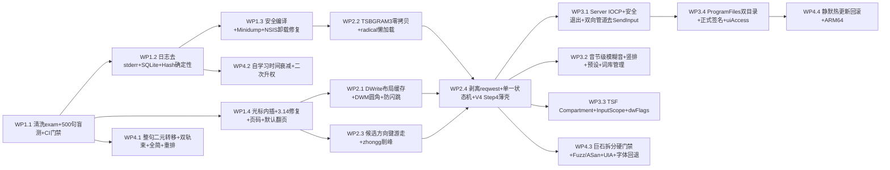

# 泰深输入法（taishenIME）商业化升级与工程强化实施计划书

> **制定日期**：2026-11-23
> **基线版本**：`v0.1.90`（`HEAD: 58759b7`）
> **目标版本路线**：`v0.1.91`（Phase 1）→ `v0.2.0`（Phase 2）→ `v0.2.5`（Phase 3）→ `v0.3.0`（Phase 4）
> **依据文档**：[商业化对标与工程强化评估方案-2026-11-23.md](商业化对标与工程强化评估方案-2026-11-23.md)（v2.0 五维评估） · [ARCHITECT-V4.md](ARCHITECT-V4.md) · [CASE-AUDIT.md](modules/exam/CASE-AUDIT.md) · [DIAGNOSIS-20261121.md](modules/sentence-quality/DIAGNOSIS-20261121.md) · [EVAL-20261122.md](modules/dict-memory/EVAL-20261122.md)

---

## 〇、实施总纲与工程铁律

本计划书将 v2.0 评估方案的五大商业化维度（**系统工程底座 · 使用手感 · 易用性 · 全链路性能 · 输出质量**）拆解为 **4 个版本里程碑、16 个可独立交付的工作包（`WP1.1`–`WP4.4`）**，每个工作包均给出精确的代码改点、接口契约、验证命令与量化门禁（DoD）。

### 三条刚性工程铁律

1. **严守 V4 免重启兼容契约（[ARCHITECT-V4.md §五·V4](ARCHITECT-V4.md#L122-L126)）**
   主协议版本冻结在 `kRenderIpcVersion = 3`（向下兼容 `v=2`）。所有新增字段（如 `cursorPos`、候选高亮、竖排标志、下行控制帧）一律通过 JSON 可选字段与能力位增量演进；旧版 DLL 忽略未知字段，保证覆盖升级后**「旧 DLL + 新 Server」免重启无缝运行**。
2. **先立可信标尺、再动架构与算法**
   `Phase 1` 首日先按 [CASE-AUDIT.md](modules/exam/CASE-AUDIT.md) 清洗 `exam-cases.tsv` 中 22 条失真用例并固化 500 句分层盲测集，将 `cargo test` / `clippy` / `exam` / CTest 接入 GitHub Actions PR 门禁，杜绝“边改边漏、拿失真试卷当准绳”。
3. **小步闭环、开关保护、随时可回滚**
   每个工作包控制在 **0.5–3 人日** 粒度，涉及架构切换（V4 Step 4、IOCP、布局缓存、二元概率转移）均保留配置或回退路径直至全宿主回归通过。

---

## 一、全局工作包分解（WBS）与关键路径拓扑

### 1.1 阶段与工期概览

| 阶段 | 目标版本 | 建议周期 | 核心聚焦 | 包含工作包 |
| :--- | :---: | :---: | :--- | :--- |
| **Phase 1** | `v0.1.91` | **1–2 周**（~8 人日） | 评测清洗与 CI 门禁 · 日志/SQLite/崩溃/卸载止血 · 手感四大痛点修复 | `WP1.1` `WP1.2` `WP1.3` `WP1.4` |
| **Phase 2** | `v0.2.0` | **2–3 周**（~12 人日） | D2D 布局缓存与防跳 · `TSBGRAM3` 零拷贝 · 候选方向键游走与削峰 · V4 Step 4 薄壳 `<500 KB` | `WP2.1` `WP2.2` `WP2.3` `WP2.4` |
| **Phase 3** | `v0.2.5` | **2–4 周**（~15 人日） | `taishen_server` IOCP 与双向管道 · 易用性全面升级 · TSF 标准契约 · `Program Files` + 正式签名 | `WP3.1` `WP3.2` `WP3.3` `WP3.4` |
| **Phase 4** | `v0.3.0` | **长期持续** | 整句算法破局（二元转移+双轨束+全简+神经重排） · 自学习防污染 · 巨石拆分硬门禁 · 更新与 ARM64 | `WP4.1` `WP4.2` `WP4.3` `WP4.4` |

### 1.2 依赖拓扑图（Critical Path）

> **关键路径**：`WP1.1` → `WP1.2` → `WP1.3` → `WP2.2` → `WP2.4`（V4 Step 4 薄壳收口）→ `WP3.1`（IOCP + 双向管道）→ `WP3.4`（`Program Files` + 商业签名 + `uiAccess`）。

---

## 二、Phase 1（`v0.1.91`）实施细则：止血、手感基石与评测地基

### 【WP1.1】评测试卷清洗、500 句分层盲测集与 CI 自动门禁
- **负责领域**：输出质量基线 · CI/CD 工程门禁
- **涉及文件**：
  - [engine/tests/exam-cases.tsv](../engine/tests/exam-cases.tsv)、[engine/examples/exam.rs](../engine/examples/exam.rs)
  - `engine/tests/benchmarks/longbench-500.tsv`（新建）、`resources/common.db` / `common_dict.txt`
  - `.github/workflows/ci-verify.yml`（新建）、[platform/windows/CMakeLists.txt](../platform/windows/CMakeLists.txt)
- **具体实施步骤**：
  1. **清洗 `exam-cases.tsv`（按 [CASE-AUDIT.md §六](modules/exam/CASE-AUDIT.md#L131-L139) 执行）**：
     - 删除 11 条矛盾/冗余用例（`L137, L138, L222, L224, L235, L248, L251, L322, L329, L330, L331`）；
     - 修正 11 条断言与范围（`L131 gaodengxuexiao`、`L140 妈妈 5`、`L147 huaer`、`L218 wmy !万美元 3`、`L244 我爱你吗`、`L245 woainima @no_src=Combo 3`、`L286 nihao @no_src=Fuzzy 3`、`L324 de 4`、`L325 wo 4`、`L358 api API 1`、`L397 suanfa !断法 5`）；
     - 补齐 `L413` 缺失第 3 列（`xian	@count>=1	1	traditional=on`），将 `L411`/`L412` 增补简繁异形词用例（`zhongguo→中國`、`diannao→電腦`）；在常用字表提升「饿」优先级使 `L54 e→饿 5` 通过。
  2. **升级 `exam.rs` 评测维度**：增加 `--metrics` 模式，统计并输出 **Top-1 / Top-3 / Top-5 命中率、MRR、KSPC（每字击键数）、前缀稳定率与精确词误伤率**。
  3. **建立 500 句分层盲测集**：将 `tmp/lb-*.tsv`（270 条）迁入 `engine/tests/benchmarks/`，扩充覆盖即时通讯（200 句）、办公公文（100 句）、科技中英混输（100 句）、高频同音虚实词（100 句）的 500 句盲测集（严禁在词库/规则中针对盲测句硬编码）。
  4. **建立 PR/Push 强制 CI（`.github/workflows/ci-verify.yml`）**：
     - Rust 门禁：`cargo fmt --manifest-path engine/Cargo.toml --check`、`cargo clippy --manifest-path engine/Cargo.toml --all-targets -- -D warnings`、`cargo test --manifest-path engine/Cargo.toml --release -- --test-threads=1`、`cargo check --manifest-path engine/Cargo.toml --release --target i686-pc-windows-msvc`；
     - 质量门禁：运行清洗后 `exam`（基线 `284/284`）与 500 句基准校验不低于基线；
     - 平台门禁：跑通 [tools/check-structure.ps1](../tools/check-structure.ps1) 并将 [CMakeLists.txt](../platform/windows/CMakeLists.txt#L313-L398) 的 `test_*` 冒烟程序纳入 CTest 执行（含 `test_config_reader`、`test_ui_framework`、`test_ui_controls`、`test_imm32_load`、`test_voice` 等无交互单测）。
- **验证与验收**：PR 提交后 GitHub Actions `ci-verify` 全绿，清洗后 `exam` 稳定通过率 **100%（284/284）**。

---

### 【WP1.2】运行时止血：日志治理、SQLite 收口、确定性消除与清理托盘死代码
- **负责领域**：系统稳定性 · 隐私与跨进程无污染 · 确定性
- **涉及文件**：
  - [engine/src/log.rs](../engine/src/log.rs)、[platform/windows/src/debug_log.cpp](../platform/windows/src/debug_log.cpp)
  - [engine/src/dictionary/write_back.rs](../engine/src/dictionary/write_back.rs)、[engine/src/dictionary/mod.rs](../engine/src/dictionary/mod.rs)、[engine/src/ffi.rs](../engine/src/ffi.rs)、[engine/src/lib.rs](../engine/src/lib.rs)
  - [platform/windows/src/tsf_module.cpp](../platform/windows/src/tsf_module.cpp)
- **具体实施步骤**：
  1. **移除 `stderr` 宿主污染与日志轮转**：
     - [log.rs#L79](../engine/src/log.rs#L79) 移除无条件 `eprint!("{}", line)`（仅当 `cfg!(test)` 或显式设置环境变量 `TAISHEN_STDERR_LOG=1` 时输出）；[#L40](../engine/src/log.rs#L40) 改用本地系统时间，并在写入前检查文件大小（超过 `5 MB` 自动轮转为 `engine.log.1`，最多保留 2 份）；
     - [debug_log.cpp#L42-L70](../platform/windows/src/debug_log.cpp#L42-L70) 为 `s_path`/`s_hLog` 初始化加 `std::mutex` 保护，`CreateFileW` 共享标志改为 `FILE_SHARE_READ | FILE_SHARE_WRITE | FILE_SHARE_DELETE`，同样增加 `5 MB` 滚动截断。
  2. **收敛全部 SQLite 裸连**：
     - 在 [write_back.rs](../engine/src/dictionary/write_back.rs) 抽出 `pub(crate) fn open_user_db(path: &Path) -> rusqlite::Result<Connection>`（统一执行 `WAL` + `synchronous=NORMAL` + `busy_timeout=2000`）；
     - 替换 [dictionary/mod.rs](../engine/src/dictionary/mod.rs) 全部 7 处裸调 `Connection::open(&path)`：`load_user_dict`（#L2285）、`load_pin_demote_state`（#L6284）、`save/remove_pin/demoted_word`（#L6318, #L6337, #L6359, #L6378）、`load_context_pairs`（#L6739）；
     - 重构 [ffi.rs#L193-L214](../engine/src/ffi.rs#L193-L214)：在 `engine_set_user_dict_path` 激活路径上复用同一个 `Connection` 一次性读取 `user_dict`、`pin_words`/`demoted_words` 与 `context_pairs`（替代原来的 3 次建连），并把 [#L214](../engine/src/ffi.rs#L214) 与 [lib.rs#L5880](../engine/src/lib.rs#L5880) 硬编码的 `per_prev = 8` 改为读取 `crate::tuning::tuning().learned_context_cap`。
  3. **消除同分随机 Hash 非确定性**：
     - 在 [dictionary/mod.rs#L2951-L2955](../engine/src/dictionary/mod.rs#L2951-L2955) 与 [#L3097-L3101](../engine/src/dictionary/mod.rs#L3097-L3101) 的 `abbrev_span_candidates` 排序比较器末尾追加 `.then_with(|| a.0.cmp(&b.0))`；全仓检索 `HashMap::into_iter` / `HashSet::into_iter` 产出候选路径，确保全部经过确定性排序键。
  4. **物理清理废弃托盘死代码**：
     - 删除 [tsf_module.cpp#L55-L56](../platform/windows/src/tsf_module.cpp#L55-L56)、[#L1508-L2160](../platform/windows/src/tsf_module.cpp#L1508-L2160)（保留 `TrayWndProc` 内或迁移 `ReloadConfigIfChanged` 检查逻辑前先确认调用链——当前配置检查已在 `OnSetFocus` 与 `OnKeyDown` 触发，见 [#L2920](../platform/windows/src/tsf_module.cpp#L2920)）以及 [#L3018-L3020](../platform/windows/src/tsf_module.cpp#L3018-L3020)、[#L3260-L3262](../platform/windows/src/tsf_module.cpp#L3260-L3262) 空桩调用，净减 ~400 行死代码；清理仓库根目录 `.obj` 残留并在 `.gitignore` 屏蔽 `*.obj`。
- **验证与验收**：单元测试验证并发写 `user_dict.db` 零 `SQLITE_BUSY`；CLI 连续跑 10 次 `lb-全简.tsv` 输出字节级 100% 一致；任意控制台宿主（如 `pwsh` / `python`）加载 DLL 时 `stderr` 为 0 字节输出。

---

### 【WP1.3】编译安全加固、Minidump 崩溃取证与 NSIS 卸载止血
- **负责领域**：安全合规 · 可运维取证 · 交付干净度
- **涉及文件**：
  - [platform/windows/CMakeLists.txt](../platform/windows/CMakeLists.txt)、[engine/Cargo.toml](../engine/Cargo.toml)
  - [platform/windows/src/taishen_server.cpp](../platform/windows/src/taishen_server.cpp)、[install/install.nsi](../install/install.nsi)
- **具体实施步骤**：
  1. **编译器安全加固与 LTO 优化**：
     - 在 [CMakeLists.txt](../platform/windows/CMakeLists.txt) 为所有目标开启 `/W4`（核心自研文件先行清零告警）、`/Zi`、`/guard:cf`；链接选项增加 `/DEBUG`、`/OPT:REF`、`/OPT:ICF`、`/GUARD:CF`、`x64` 目标增加 `/CETCOMPAT`；
     - 在 [engine/Cargo.toml](../engine/Cargo.toml) 新增 `[profile.release]`：`lto = "thin"`、`codegen-units = 1`。
  2. **接入 `MiniDumpWriteDump` 与 `.pdb` 归档**：
     - 在 [taishen_server.cpp#L953-L967](../platform/windows/src/taishen_server.cpp#L953-L967) 的 `ServerCrashFilter` 中动态加载 `dbghelp.dll` 调用 `MiniDumpWriteDump`（`MiniDumpNormal`），写入 `%LOCALAPPDATA%\TaishenIME\crash\taishen_server_<version>_<pid>.dmp`（自动清理超过 5 份的旧 dump）；CI 同步打包上传全部 `.pdb`。
  3. **修复 NSIS 卸载残留与版本号失配**：
     - 在 [install.nsi#L380-L384](../install/install.nsi#L380-L384) 使用 `!searchparse` 或从 `/DVERSION=x.y.z` 拆解写入 `VersionMajor`/`VersionMinor`；
     - 在卸载段（[#L441-L465](../install/install.nsi#L441-L465)）补充 `Rename` + `Delete /REBOOTOK` 清理 `$INSTDIR\lm\lm_cache.bin*`、`lm_data.bin`、`lm_words.json`、`RMDir "$INSTDIR\lm"` 与 `$INSTDIR\TaishenIME-Dev-Root.cer`。
- **验证与验收**：`dumpbin /loadconfig` 检查二进制已启用 `GuardCF` 与 `CET`；主动触发测试崩溃可生成能被 WinDbg + `.pdb` 还原完整栈的 `.dmp`；运行卸载后 `$INSTDIR` 目录彻底消失无残留。

---

### 【WP1.4】四大手感断层即时修复（拼音光标编辑、数字后小数点、页码指示、默认 `-/=` 翻页）
- **负责领域**：使用手感与微交互（快速高回报修复）
- **涉及文件**：
  - [engine/src/lib.rs](../engine/src/lib.rs)、[engine/src/ffi.rs](../engine/src/ffi.rs)、[platform/windows/include/engine_bridge.h](../platform/windows/include/engine_bridge.h)、[platform/windows/include/render_ipc.h](../platform/windows/include/render_ipc.h)
  - [platform/windows/src/tsf_keyevent.cpp](../platform/windows/src/tsf_keyevent.cpp)、[platform/windows/src/tsf_module.cpp](../platform/windows/src/tsf_module.cpp)、[platform/windows/src/tsf_composition.cpp](../platform/windows/src/tsf_composition.cpp)、[platform/windows/src/taishen_server.cpp](../platform/windows/src/taishen_server.cpp)、[platform/windows/src/candidate_window.cpp](../platform/windows/src/candidate_window.cpp)、[platform/windows/include/config_reader.h](../platform/windows/include/config_reader.h)
- **具体实施步骤**：
  1. **拼音内光标插入、导航与可视化**：
     - 修改 [engine/src/lib.rs#L1141-L1143](../engine/src/lib.rs#L1141-L1143)：`process_key` 在 `self.cursor <= self.pinyin_buf.len()` 时通过 `self.pinyin_buf.insert(self.cursor, ch.to_ascii_lowercase())` 插入（`raw_input` 同步插入）并 `self.cursor += 1`；新增 `move_cursor_char(delta: i32)` 与 `set_cursor_edge(to_start: bool)` 方法并在 [ffi.rs](../engine/src/ffi.rs) / [engine_bridge.h](../platform/windows/include/engine_bridge.h) 导出；
     - 在 [tsf_keyevent.cpp](../platform/windows/src/tsf_keyevent.cpp) 的 `EvalEngineKeyEat` 与 `HandleKeyDown`（同步至 [taishen_server.cpp::ProcessServerKeyInputLocked](../platform/windows/src/taishen_server.cpp#L573)）：当 `hasPinyin` 时接管 `VK_LEFT`/`VK_RIGHT`（带 `Ctrl` 调 `engine_move_cursor(±1)`，无 `Ctrl` 调字符级左右移）、`VK_HOME`/`VK_END`（跳至 `0` / 末尾），并删除 [tsf_module.cpp#L3148-L3155](../platform/windows/src/tsf_module.cpp#L3148-L3155) 不可达分支；
     - 在 [render_ipc.h#L72-L128](../platform/windows/include/render_ipc.h#L72-L128) 的 `CandidateListResponse` 与 `RenderCommand` 增加可选字段 `int32_t cursorPos = -1`（遵循 V4 兼容约定）；通过已有 FFI `engine_get_cursor()`（[engine_bridge.h#L214](../platform/windows/include/engine_bridge.h#L214)）换算出含 `'` 分隔符后的显示偏移，在 [tsf_composition.cpp#L343](../platform/windows/src/tsf_composition.cpp#L343) 将文档组合区选区定位到精确光标偏移，并在 [candidate_window.cpp#L315-L322](../platform/windows/src/candidate_window.cpp#L315-L322) 非行内模式下于对应字符位置绘制 1.5px 垂直光标线。
  2. **修复直敲数字后 `.` / `,` / `:` 变成全角标点 Bug**：
     - 在 [tsf_module.cpp#L3008-L3015](../platform/windows/src/tsf_module.cpp#L3008-L3015)、`HandleRemoteKeyDown` 及 [imm32_ime.cpp](../platform/windows/src/imm32/imm32_ime.cpp) 中，当按键走透传分支（`!eat`）时判断：`!ctrlDown && !altDown && ((!shiftDown && effVk >= '0' && effVk <= '9') || (rawVk >= VK_NUMPAD0 && rawVk <= VK_NUMPAD9))`，命中则置 `g_lastCommitEndsWithDigit = true`，其余非修饰键按下置 `false`；
     - 在 [tsf_keyevent.cpp#L286,L561](../platform/windows/src/tsf_keyevent.cpp#L286) 放宽条件：当 `g_lastCommitEndsWithDigit` 为真时，除不带 Shift 的 `,` / `.` 外，带 Shift 的 `:`（`VK_OEM_1 && shiftDown`）同样直通半角（不吞键）。
  3. **候选窗页码指示**：
     - 在 [candidate_window.cpp#L161-L383](../platform/windows/src/candidate_window.cpp#L161-L383) 中，当 `m_totalPages > 1` 时在窗口右侧/右上角以 `m_theme.dim` 绘制 `‹ {page+1}/{totalPages} ›`，命中 `‹`/`›` 点击区域时调用 `m_pageCb(±120)`。
  4. **默认开启 `-/=` 翻页**：
     - 将 [config_reader.h#L89](../platform/windows/include/config_reader.h#L89) 中 `bool page_minus_equal = true;` 设为出厂默认值。
- **验证与验收**：在记事本/VS Code 中输入 `nihao`，按 `←` 两次再打 `x` 可准确插入对应位置且组合光标同步移动；中文模式下直接敲 `3.14`、`1,000`、`14:30` 输出精确半角；翻页时可见 `1/4` 页码；按 `-`/`=` 翻页开箱可用。

---

## 三、Phase 2（`v0.2.0`）实施细则：V4 薄壳终局与全链路极速化

### 【WP2.1】DirectWrite 布局缓存、Win11 DWM 原生圆角与首帧防闪跳
- **负责领域**：全链路性能 · 视觉质感 · 手感跟手度
- **涉及文件**：
  - [platform/windows/include/ui_render.h](../platform/windows/include/ui_render.h)、[platform/windows/src/ui_render.cpp](../platform/windows/src/ui_render.cpp)
  - [platform/windows/src/candidate_window.cpp](../platform/windows/src/candidate_window.cpp)、[platform/windows/src/tsf_module.cpp](../platform/windows/src/tsf_module.cpp)
- **具体实施步骤**：
  1. **布局对象预构建缓存（消除 50–126 次每键 COM 创建销毁）**：
     - 在 `UIRenderer` 新增 `IDWriteTextLayout* CreateTextLayout(const std::wstring& text, float size, bool bold, const std::wstring& fontFace)` 与 `DrawTextLayout(D2D1_POINT_2F origin, IDWriteTextLayout* layout, D2D1_COLOR_F color)`；
     - 在 `CCandidateWindow::CandidatePanel` 引入 `struct CachedCandLayout`（持有 `labelLayout`/`wordLayout`/`commentLayout`、各段宽度 `labelW`/`wordW`/`commentW` 与 `hitRect`）及脏标记 `m_layoutDirty`，仅在 `SetData` / `SetFont` / `SetLayout` / `SetMultiRow` / DPI 变化时构建一次（RAII 释放旧布局）；`CalculateSize`、`Draw`、`CandidateAt` 全部复用缓存，确保 `OnMouseMove` 0 次布局分配。
  2. **Win11 DWM 原生圆角与投影**：
     - 在 `CCandidateWindow::Initialize`（及 `CBannerWindow`）检测系统版本为 Win11（Build ≥ 22000）时，调用 `DwmSetWindowAttribute(hwnd, DWMWA_WINDOW_CORNER_PREFERENCE /*33*/, &DWMWCP_ROUND /*2*/, sizeof(DWORD))`，不再调用 `CreateRoundRectRgn`/`SetWindowRgn` 锯齿裁剪（Win10 保留 Region 降级）。
  3. **消除异步光标首帧鼠标跳动**：
     - 在 [tsf_module.cpp#L4036-L4063](../platform/windows/src/tsf_module.cpp#L4036-L4063)：若 `caretHr == TF_S_ASYNC` 且 `!m_hasLastCaretRect` 且 `GetCaretRectFromGuiThread` 失败，记录 `m_pendingFirstShow = true` 并启动 `10 ms` 一次性计时/短等；若 `10 ms` 内 `OnCaretRectResolved` 到达则一步到位弹出在真实光标处，超时才降级鼠标坐标。
- **验证与验收**：QPC 测量 `CandidatePanel::UpdateState` + `OnRender` 耗时 `< 0.2 ms`；Taskbar Search / Win11 记事本首键弹出无“鼠标→输入框”瞬移跳动。

---

### 【WP2.2】`bigram.db.bin` 升级 `TSBGRAM3` 零拷贝 mmap 与 `radical` 懒加载
- **负责领域**：内存治理 · 首键零毛刺
- **涉及文件**：
  - [engine/src/dictionary/mapped.rs](../engine/src/dictionary/mapped.rs)、[engine/src/dictionary/mod.rs](../engine/src/dictionary/mod.rs)
  - [engine/src/radical.rs](../engine/src/radical.rs)、[engine/src/bin/build_index.rs](../engine/src/bin/build_index.rs)、[package.ps1](../package.ps1)
- **具体实施步骤**：
  1. **定义 `TSBGRAM3` 零拷贝 mmap 格式（预计 `.bin` 约 `4.2 MB`，跨进程物理页 100% 共享）**：
     - 复用 [mapped.rs](../engine/src/dictionary/mapped.rs) 的 `Backing::{Mmap, Owned}` 与 `SEC_WORD_POOL`：新增 `BIGRAM_CONTAINER_MAGIC = b"TSBGRAM3"`（`SEC_BIGRAM_WORD_POOL` + `SEC_BIGRAM_PREV_KEYS` + `SEC_BIGRAM_EDGES`，每条边仅存定长 `4B`：`next_word_id(24b) | tier(8b)`），提供 O(log N) 二分查前词 + `find_tier(prev, next)` 零堆分配查询；
     - 替换 [dictionary/mod.rs#L6417-L6547](../engine/src/dictionary/mod.rs#L6417-L6547) 的 `HashMap` + `bincode::deserialize`，在 `bigram.db.bin` 缺失/版本旧时原子构建 `TSBGRAM3` 并即刻 `open_mmap`，同步纳入 [package.ps1](../package.ps1) 预生成及 [install.nsi](../install/install.nsi) `.old.<ts>` 改名保护。
  2. **`radical_pinyin.dict.yaml` 懒加载 / 预编译**：
     - 修改 [engine/src/radical.rs](../engine/src/radical.rs)：`init(path)` 仅记录路径（耗时 `< 0.01 ms`），直到首次 `radical::query`（用户输入 `u` 前缀进入拆字反查模式）时再按 `OnceLock` 加载（或打包期预编成简单 `TSRAD001` mmap 容器）。
- **验证与验收**：`mapped_check` 校验 38.6 万对 `bigram` 查询 0 差异；单实例引擎常驻私有内存从 `39.8 MB` 降至 **`< 12 MB`**；首次切换输入法无 `200 ms` 后台线程尖峰与 YAML 解析卡顿。

---

### 【WP2.3】候选高亮方向键游走与 `zhongg` 过渡态尾延迟削峰
- **负责领域**：使用手感 · 尾延迟性能优化
- **涉及文件**：
  - [engine/src/lib.rs](../engine/src/lib.rs)、[engine/src/dictionary/mod.rs](../engine/src/dictionary/mod.rs)
  - [platform/windows/src/tsf_keyevent.cpp](../platform/windows/src/tsf_keyevent.cpp)、[platform/windows/src/taishen_server.cpp](../platform/windows/src/taishen_server.cpp)、[platform/windows/src/tsf_module.cpp](../platform/windows/src/tsf_module.cpp)
- **具体实施步骤**：
  1. **打通候选高亮导航**：
     - 在 `Engine` 维护 `selected_index: usize`（每次新查词或翻页归 `0`，切页边界时可跨页），同步经 `CandidateListResponse.selectedIndex` 下发；
     - 多行展开态（`m_multiRowExpanded`）下用 `VK_LEFT`/`VK_RIGHT`/`VK_UP`/`VK_DOWN` 移动 `selectedIndex`（单行按 `↓` 展开多行保持兼容，可配置为 `Tab`/方向键游走），`VK_SPACE` 提交当前高亮候选；激活 [tsf_module.cpp](../platform/windows/src/tsf_module.cpp) 与 [candidate_window.cpp#L602](../platform/windows/src/candidate_window.cpp#L602) 的 `SetSelectedIndex` 渲染联动。
  2. **`zhongg` 不完整音节尾缀削峰**：
     - 针对 `HANDOFF-2026-11-22` 采样的最后瓶颈（`zhongguorenmin` `limit=5` 峰值 `20.79 ms`，其中 `zhongg` 占 `15.6 ms`）：在 [dictionary/mod.rs](../engine/src/dictionary/mod.rs) `phrase_group_guess` 中识别“前序音节已闭合 + 末尾 1–2 字母不完整辅音/前缀”状态，前序片段复用 `max_err=0` 缓存，仅对末尾未闭合片段做 `SyllableTrie` 合法声母剪枝，不再在 `max_err=1/2` 下对未输入完的尾字母做全表笛卡尔枚举。
- **验证与验收**：`lat_probe` 复测 `zhongguorenmin (limit=5)` 峰值与全长句集合 **P99 `< 5.0 ms`**；416+ 单测与 284 条 `exam` 零退化。

---

### 【WP2.4】剥离 `reqwest` 依赖、收口单一按键状态机与 V4 Step 4 薄壳（`< 500 KB`）
- **负责领域**：进程边界与注入安全 · 架构收口
- **涉及文件**：
  - [engine/Cargo.toml](../engine/Cargo.toml)、[engine/src/voice.rs](../engine/src/voice.rs)
  - [platform/windows/CMakeLists.txt](../platform/windows/CMakeLists.txt)、[platform/windows/include/config_reader.h](../platform/windows/include/config_reader.h)
  - [platform/windows/src/tsf_module.cpp](../platform/windows/src/tsf_module.cpp)、[platform/windows/src/imm32/imm32_ime.cpp](../platform/windows/src/imm32/imm32_ime.cpp)、[platform/windows/src/taishen_server.cpp](../platform/windows/src/taishen_server.cpp)
- **具体实施步骤**：
  1. **剥离 `reqwest`/语音栈**：在 [engine/Cargo.toml](../engine/Cargo.toml) 新增 `[features] default = []` 与 `voice-http = ["dep:reqwest"]`，将 `reqwest` 标为 `optional = true`（或迁出为独立 crate `taishen_voice`）；仅 `taishen_server` 链接带语音传输能力。
  2. **收敛单一按键状态机**：将 [tsf_keyevent.cpp](../platform/windows/src/tsf_keyevent.cpp)、[tsf_module.cpp::HandleRemoteKeyDown](../platform/windows/src/tsf_module.cpp#L2378)、[taishen_server.cpp::ProcessServerKeyInputLocked](../platform/windows/src/taishen_server.cpp#L573) 与 [imm32_ime.cpp](../platform/windows/src/imm32/imm32_ime.cpp) 四套并存分支收口——服务端 Rust 引擎统一输出标准化 `KeyAction`（`eaten` / `preedit` / `cursorPos` / `candidates` / `committed` / `caretOffset` / `inCompose`），客户端只做按键转发、快捷键本地快判与文档写回；同时为 IMM32 兼容层补齐 `config.ini` mtime 热加载（解决 `40eeb7c` 遗留）。
  3. **外移设置窗、工具栏与语音进 `taishen_server.exe`**：语言栏右键「属性设置…」通过管道消息唤醒 `taishen_server.exe` 弹窗（进程外修改保存后自动重载并广播设置生效）；工具栏与语音由 server UI 线程统一托管。
  4. **切换 V4 Step 4 终局并物理拆解 `tsf_module.cpp`**：将 [config_reader.h#L197-L199](../platform/windows/include/config_reader.h#L197-L199) 默认 `use_server_render = true`、`use_server_engine = true`；经全宿主长稳验证后，从 `taishen_ime` 与 `taishen_ime_imm32` CMake 目标彻底移除 `taishen_engine`、`d2d1`、`dwrite` 与 `ui_*.cpp`；将 4,493 行 `tsf_module.cpp` 拆为 `tsf_text_service.cpp`、`tsf_key_sink.cpp`、`tsf_edit_session.cpp`、`tsf_langbar.cpp`、`tsf_focus_caret.cpp`（各 `< 1,000` 行）。
- **验证与验收**：`taishen_ime.dll` / `taishen_ime_x86.dll` 体积 **`< 500 KB`**，`dumpbin /dependents` 无 `d2d1.dll` / `DWrite.dll`；端到端（TSF→IPC→引擎→D2D）**P99 `< 12 ms`**；浏览器、Office、VS Code、Taskbar Search、Win11 记事本、微信/QQ、游戏（含 IMM32）全宿主回归通过。

---

## 四、Phase 3（`v0.2.5`）实施细则：服务生产级加固、易用性升级与 TSF 标准契约

### 【WP3.1】`taishen_server.exe` IOCP 重构、优雅退停、多会话上下文与双向交互
- **负责领域**：后台服务高并发 · 生命周期零崩溃 · 跨进程交互闭环
- **涉及文件**：
  - [platform/windows/src/taishen_server.cpp](../platform/windows/src/taishen_server.cpp)、[platform/windows/include/render_ipc.h](../platform/windows/include/render_ipc.h)、[platform/windows/src/ipc_render_client.cpp](../platform/windows/src/ipc_render_client.cpp)
  - [engine/src/ffi.rs](../engine/src/ffi.rs)、[engine/src/lib.rs](../engine/src/lib.rs)
- **具体实施步骤**：
  1. **消除退出期栈 UAF 与关机丢词**：将 `wWinMain` 栈上 `ServerState state`（[#L1472](../platform/windows/src/taishen_server.cpp#L1472)）改为 `std::shared_ptr<ServerState>`；登记所有活动管道句柄与工作线程句柄；收到退出指令时置位 `shuttingDown`、对管道调 `CancelIoEx`、等待工作线程池全部 join 后再执行 `engine_flush_user_writes(1)` 与 `engine_destroy()`；在 `ServerMsgWndProc` 拦截 `WM_QUERYENDSESSION` / `WM_ENDSESSION` 同步刷盘。
  2. **IOCP 异步管道 + 空闲 0 CPU 唤醒**：用 Windows I/O Completion Port + 2–4 线程工作池替换 1 连接 1 `detach()` 线程与 `kMaxPipeConnections = 64` 硬上限；闲置连接超时（如 10 分钟）安全关闭句柄而保留会话 ID；取消常驻 2s `WM_TIMER` 轮询，改为 `ReadDirectoryChangesW` 监听 `config.ini` + 仅当存在未落盘用户词时启动一次性 2s 刷盘定时器（静默期 0 唤醒）。
  3. **只读词库共享 + 多会话上下文隔离**：将 `Engine` 内可变输入状态（`pinyin_buf`/`cursor`/`candidates`/`compose_*`/`page`）从 [ffi.rs#L15](../engine/src/ffi.rs#L15) 剥离为 `HashMap<u64, InputSession>`（LRU 最多保留 32 活跃会话），多个窗口快速来回切换不再互相清空未提交拼音。
  4. **彻底移除 `SendInput` 并打通进程外候选右键菜单**：
     - 废弃 [taishen_server.cpp#L348-L362,L1500-L1507](../platform/windows/src/taishen_server.cpp#L348-L362) 的 `SendVirtualKey`；
     - 扩展 `v=3` 协议可选下行事件（如宿主短周期/长连接挂起通知或输入上下文回调帧 `RemoteAction { select_index, page_delta, commit_text }`），实现容器内/外左键点击任意第 1–20 个候选、滚轮翻页、以及 **右键置顶/取消置顶/降权/删词菜单**（解决 `40eeb7c` 遗留项）100% 不依赖 `SendInput`。
  5. **消除 5 秒重连黑洞**：[ipc_render_client.cpp#L479](../platform/windows/src/ipc_render_client.cpp#L479) 触发重拉 `taishen_server.exe` 后，通过 `OpenMutexW(SYNCHRONIZE, FALSE, kServerMutexName)` + `50ms / 150ms / 500ms` 三阶短探测提前清除 `m_hardFailUntil`。
- **验证与验收**：并发 100+ 命名管道客户端压测稳定无拒连；杀进程/注销关机/重启零 UAF 且用户词 0 丢失；`candidate_count=15` 时点击第 12 项精确上屏；容器内右键置顶/删词即时生效；断连自拉恢复 `< 200 ms`。

---

### 【WP3.2】易用性全面升级（独立模糊音、竖排候选、习惯预设、进程拾取与词库管理）
- **负责领域**：易用性与全场景体验
- **涉及文件**：
  - [engine/src/fuzzy.rs](../engine/src/fuzzy.rs)、[engine/src/shuangpin.rs](../engine/src/shuangpin.rs)
  - [platform/windows/include/config_reader.h](../platform/windows/include/config_reader.h)、[platform/windows/src/config_reader.cpp](../platform/windows/src/config_reader.cpp)、[platform/windows/src/settings_window.cpp](../platform/windows/src/settings_window.cpp)、[platform/windows/src/candidate_window.cpp](../platform/windows/src/candidate_window.cpp)
- **具体实施步骤**：
  1. **9 组音节级可控模糊音（默认关闭）**：
     - 修改 `config_reader.h#L116`：`fuzzy_enabled = false`，新增 `uint16_t fuzzy_flags = 0`（9 位独立开关：`z↔zh`、`c↔ch`、`s↔sh`、`an↔ang`、`en↔eng`、`in↔ing`、`n↔l`、`f↔h`、`r↔l`）；
     - 重写 [fuzzy.rs](../engine/src/fuzzy.rs)：基于 `SyllableTrie` 先切音节再按**音节声母首部**与**韵母尾部**精确替换，彻底杜绝 `"zhang"→"zhhang"`、`"fan"→"fal"` 等越界生成；设置页「输入」展示 9 组独立勾选框。
  2. **竖排候选窗布局**：
     - `ImeConfig` 新增 `int candidate_layout = 0`（`0=横排`，`1=竖排`）；[candidate_window.cpp](../platform/windows/src/candidate_window.cpp) 支持每条候选独立占行、长句自动展示不被横向 800 DIP 截断、顺畅显示 `\t` 注释与多音/拆字提示。
  3. **习惯一键预设 & 修复双拼虚假项 & 保护「恢复默认」**：
     - 设置页顶部提供一键预设按钮（「搜狗风格」「微软风格」「Rime 风格」）；
     - 在 [shuangpin.rs](../engine/src/shuangpin.rs) 真实补全 `ziguang`（紫光）与 `jiajia`（拼音加加）编码表，移除误导提示；
     - 修改 [settings_window.cpp#L708-L711](../platform/windows/src/settings_window.cpp#L708-L711)「恢复默认」，仅恢复常规参数并保留 `m_appData`（另设“清空应用规则”显式按钮）。
  4. **进程拾取器、词库管理页与首次引导卡片**：
     - 「高级 → 应用级配置」新增「选择当前打开窗口…」下拉拾取进程名（通过 `EnumWindows` 枚举带标题窗口并取 `.exe` 基名），并内置常见终端/IDE/主流全屏游戏出厂白名单；
     - 新增第 9 个导航页「词库」：显示各词库版本与词条数、置顶/降权/用户词检索删除、TXT/TSV 导入导出与一键清空自学习历史；
     - 为首次安装完成打开轻量 1 页「上手设置向导」（选拼音模式/竖横排/翻页习惯）及为特殊模式（`v`/`u`/`c`/`R`/`U`）首字加灰色模式标签。
- **验证与验收**：单测验证 `fuzzy_variants("zhang")` 不含 `"zhhang"`/`"zhangg"`、`fuzzy_variants("fan")` 不含 `"fal"`；竖排模式在高 DPI 下多页与注释对齐无截断；TXT 词库导入导出往返无损。

---

### 【WP3.3】Windows TSF 标准系统契约补全（`Compartment` / `InputScope` / `dwFlags`）
- **负责领域**：Windows 系统兼容性 · 第三方工具与密码框安全
- **涉及文件**：[tsf_module.cpp](../platform/windows/src/tsf_module.cpp)（拆分后新建 `tsf_compartment.cpp`、`tsf_input_scope.cpp`）
- **具体实施步骤**：
  1. **`ITfCompartment` 双向状态同步**：实现读写与 `ITfCompartmentEventSink` 订阅 `GUID_COMPARTMENT_KEYBOARD_OPENCLOSE`、`GUID_COMPARTMENT_KEYBOARD_INPUTMODE_CONVERSION`、`GUID_COMPARTMENT_KEYBOARD_DISABLED` 与 `GUID_COMPARTMENT_EMPTYCONTEXT`，保证 VS Code `im-select`、Neovim 自动切换与 Windows 系统托盘状态指示器原生同步。
  2. **`ITfInputScope` 语境自适应与隐私保护**：从当前焦点 `ITfContext` 查询 `GUID_PROP_INPUTSCOPE` → `ITfInputScope::GetInputScopes`：命中 `IS_PASSWORD`、`IS_URL`、`IS_EMAIL_SMTPADDR`、`IS_NUMBER` 时自动临时切英文直通且不进用户词/上下文学习。
  3. **`ActivateEx` 解析 `dwFlags`**：响应 `TF_TMF_UIELEMENTENABLEDONLY`、`TF_TMF_IMMERSIVEMODE`、`TF_TMF_CONSOLE` 标记，并在 `DllRegisterServer` 注册 `GUID_TFCAT_TIPCAP_SECUREMODE`。
- **验证与验收**：在 Edge/Chrome 密码框、Windows 登录/安全框、`im-select.exe` 调用测试中 100% 按契约自动切英文与状态互通。

---

### 【WP3.4】标准 `%ProgramFiles%` 双目录安装、正式代码签名与 `uiAccess="true"` 闭环
- **负责领域**：商业发行信任链 · 多用户兼容 · 零阻力安装体验
- **涉及文件**：[install/install.nsi](../install/install.nsi)、[platform/windows/CMakeLists.txt](../platform/windows/CMakeLists.txt)、[package.ps1](../package.ps1)、[.github/workflows/windows-build.yml](../.github/workflows/windows-build.yml)、[settings_window.cpp](../platform/windows/src/settings_window.cpp)
- **具体实施步骤**：
  1. **迁移到 `%ProgramFiles%\TaishenIME\`**：[install.nsi#L25](../install/install.nsi#L25) 将 `InstallDir` 改为 `$PROGRAMFILES64\TaishenIME`（只读二进制与 `.bin` 词库），用户数据 `config.ini`、日志、`user_dict.db` 统一读/写 `%LOCALAPPDATA%\TaishenIME\`（首次升级自动从旧目录静默迁移用户已有 `config.ini`）；自启写入 `HKLM\Software\Microsoft\Windows\CurrentVersion\Run`。
  2. **构建期嵌入 `uiAccess="true"`**：在 `CMakeLists.txt` 为 `taishen_server` 目标配置 `MANIFESTUAC "level='asInvoker' uiAccess='true'"`；确认 `SignPath` 正式代码签名证书生效并能过 Windows Defender SmartScreen 校验。
  3. **下线自签 Root CA 流程**：正式签名闭环后移除 `install.nsi` 的 `CertPageCreate` 自签根证书导入步骤及设置页第 8 页「证书」页。
- **验证与验收**：非管理员普通桌面账户通过 UAC 提权安装后可直接正常使用、Taskbar Search（Win+S）与提权命令提示符中无需任何额外证书操作即可正常显示候选窗（`uiAccess=1`, `ZBID_UIACCESS`）。

---

## 五、Phase 4（`v0.3.0`）实施细则：整句跃升、无障碍生态与运维闭环

### 【WP4.1】整句解码核心算法三项破局 + 神经重排
- **负责领域**：输出质量核心上限
- **涉及文件**：[engine/src/sentence.rs](../engine/src/sentence.rs)、[engine/src/lm.rs](../engine/src/lm.rs)、[engine/src/pinyin/mod.rs](../engine/src/pinyin/mod.rs)、[engine/src/dictionary/mod.rs](../engine/src/dictionary/mod.rs)
- **具体实施步骤**：
  1. **二元条件概率取代固定 `-17.944` 一元惩罚**：改造 [sentence.rs#L61](../engine/src/sentence.rs#L61)，当 `prev_word -> cur_word` 命中 `TSLM` 二元转移边时直接采用平滑条件对数概率 `ln P(w2 | w1)`（不再对每个分词点重复扣除 `-LN_RAW_TOTAL`），解决「刚+到」输给「钢刀」问题。
  2. **同音高歧义对双轨束搜索（Diverse Beam）**：在 `prune_at` 中对高频虚实冲突组（`在/再`、`的/得/地`、`此/词`、`该/改`、`见/键` 等）强制保留次优同音实词分支（每簇上限、总束宽至少留 2 槽给异字路径），打破 Top-9 束塌缩。
  3. **纯声母全简拼词图通道**：针对 `!splits_clean` 的 3–6 字纯声母串，引入基于 `short_index`/`common_short` 的多字词跨度边和搭配重排。
  4. **补齐儿化音与本地轻量神经重排**：`pinyin/mod.rs` 支持常见儿化尾 `r` 拆分；中期引入 10–25 MB INT8 量化本地神经语言模型对 Top-8 整句候选做 `3–8 ms` CPU 重排。
- **验证与验收**：500 句盲测集冷启动达成全拼 **Top-1 `≥ 70%` / Top-5 `≥ 85%`**、全简 **Top-3 `≥ 65%`**、全场景 **KSPC `≤ 2.15`**。

### 【WP4.2】自学习时间衰减与防误学二次升权
- **负责领域**：热启动体验 · 抗词库污染
- **涉及文件**：[engine/src/dictionary/mod.rs](../engine/src/dictionary/mod.rs)、[engine/src/ranking.rs](../engine/src/ranking.rs)
- **具体实施步骤**：为 `user_index` 计分加入基于 `last_used` 的 30 天指数半衰期衰减；新自造拼凑词首次上屏以 `freq=1` 保留在系统高频精确词之后，第 2 次选中起跃升热词首屏。
- **验证与验收**：单测验证“单次误触组词不立即夺占精确词首位，连续确认 2 次后升至首位；90 天未用旧词自动降权让位”。

### 【WP4.3】巨石文件拆分硬门禁、Fuzz/PageHeap 压测、UIA 与生僻字回退
- **负责领域**：可维护性 · 无障碍生态 · 极限健壮性
- **涉及文件**：[engine/src/dictionary/*](../engine/src/dictionary/mod.rs)、[engine/src/lib.rs](../engine/src/lib.rs)、[tools/check-structure.ps1](../tools/check-structure.ps1)、[platform/windows/src/ui_render.cpp](../platform/windows/src/ui_render.cpp)、[platform/windows/src/candidate_window.cpp](../platform/windows/src/candidate_window.cpp)
- **具体实施步骤**：
  - 将 `dictionary/mod.rs`（9,026 行）拆为 `loader.rs`、`system_query.rs`、`domain.rs`、`user_dict.rs`、`combo.rs`、`tests.rs`；`lib.rs`（8,083 行）拆为 `engine_state.rs`、`candidate_gen.rs`、`key_dispatch.rs`、`compose.rs`、`tests.rs`；`check-structure.ps1` 行数门槛升为 `exit 1` 硬阻断；
  - 接入 `cargo-fuzz`（覆盖 `mapped.rs` 容器解析、`render_ipc` 帧解码、`Engine::process_key`）与 PageHeap/ASan 万次按键切窗压测；
  - [ui_render.cpp](../platform/windows/src/ui_render.cpp) 挂载 DirectWrite 生僻字（CJK Ext-B–I）字体回退链；为候选窗补齐 `WM_GETOBJECT` / `IRawElementProviderSimple`（支持 Windows 讲述人 / NVDA 读屏）及 `ITfFnReconversion`。
- **验证与验收**：`check-structure.ps1` 硬门禁 0 违规；10,000 次连续按键+切窗 PageHeap/ASan 零崩溃零泄漏；NVDA 可正常朗读候选词。

### 【WP4.4】静默自动更新器与 Windows ARM64 构建目标
- **负责领域**：商业交付运营 · 硬件生态覆盖
- **涉及文件**：`tools/updater/`（新建）、[.github/workflows/windows-build.yml](../.github/workflows/windows-build.yml)
- **具体实施步骤**：开发轻量化后台更新器（校验签名与 SHA-256，复用 `.old.<ts>` 改名热替换并平滑重启 `taishen_server.exe`，启动异常自动回滚）；CI 增加 `aarch64-pc-windows-msvc` 交叉编译产物。
- **验证与验收**：模拟发布新版本可无感静默升级且无需重启已打开应用；失败注入测试自动回滚至旧版本；ARM64 产物编译与单测通过。

---

## 六、关键风险矩阵、灰度策略与回滚预案

| 风险项 | 触发征兆 | 预防与灰度保护 | 即时回滚预案 |
| :--- | :--- | :--- | :--- |
| **V4 Step 4 全量外移导致老旧软件输入异常** | 特定宿主切出英文或按键丢失 | `WP2.4` 前保留 1 个版本 `config.ini` 开关 `use_server_engine=0` 应急逃生；先在内部灰度验证全宿主矩阵再移除旧链接 | 发布热补丁将 `config.ini` 默认切回进程内引擎或回退上一版二进制 |
| **IOCP 重构后偶发管道卡死或消息乱序** | 跨进程切换或高压打字候选不更新 | 严格保留客户端 `50ms` 请求 deadline + `seq` 序列号匹配 + 熔断自动重拉机制 | 回退 `taishen_server.cpp` 单一连接实现提交并重新打包 `taishen_server.exe` |
| **DWrite 布局缓存未监听跨屏 DPI 变更** | 主副屏不同缩放比拖动窗口文字糊或裁剪 | `CandidatePanel::OnDpiChanged` 显式置位 `m_layoutDirty = true` 并重建缩放后布局 | 暂时置 `m_layoutDirty` 每帧重建（退回旧行为仅需 1 行开关） |
| **整句二元概率改写导致短词用例波动** | 清洗后 `exam` 通过率掉出 `284/284` | `WP1.1` 先建 CI 硬门禁；仅对 `>= 3` 音节触发整句通道，词级查询链独立不变 | 通过特性常量开关 `TS_SENTENCE_LEGACY` 对照与秒级退回 |
| **`Program Files` 迁移导致老用户配置丢失** | 升级后候选数/双拼设置恢复默认 | 安装器 `PostInstall` 检测旧 `$LOCALAPPDATA\TaishenIME\config.ini` 与新配置并自动合并迁移 | 安装脚本保留旧文件备份（`.bak`）7 天可供恢复 |

---

## 七、全局质量门禁清单（Release Gate）

每次向 `master` 发布版本前，必须全部满足以下 **7 项放行条件**：
1. **自动化验证全绿**：Rust `fmt` + `clippy -D warnings` + 全部单元/集成测试 + `i686` 交叉检查 + CTest 全部 `test_*` + `check-structure.ps1` 全部 `PASS`；
2. **输出质量达标**：清洗后 `exam` **`284/284 (100%)`**，500 句分层盲测集各分项指标不低于当前阶段目标且 3 次重复跑结果 **0 字节差异**；
3. **内存与性能实测**：`TS_MEM_REPORT` + `lat_probe` + 端到端 QPC 探针符合当前阶段 P99 与私有内存预算（`Phase 2` 后薄壳 `<500 KB`、端到端 P99 `<12 ms`）；
4. **安全与可追溯性**：`dumpbin /loadconfig` 验证 `/guard:cf` 生效，Release 构建携带完整 `.pdb` 归档，无任何宿主 `stderr` 日志输出；
5. **沙箱与高权限兼容性**：Windows 11 任务栏搜索（AppContainer）、Edge、Win11 记事本、VS Code、Office、微信、游戏（IMM32）冒烟全过；
6. **安装与卸载洁净度**：标准安装、跨版本覆盖升级（老宿主免重启继续打字）、完整卸载后目录与注册表零残留；
7. **文档同步**：对应版本 `DEV-TRACKER.md`、`CHANGELOG` 与配置说明同步更新，无过时默认值描述。
