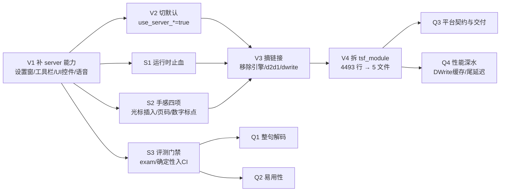

# 泰深输入法 V4 打薄与工程强化实施计划书（v2.0）

> **基线版本**：`v0.1.90`（`HEAD: 58759b7`）
> **基线快照**：[docs/baseline/v0.1.90/baseline.md](baseline/v0.1.90/baseline.md)
> **依据文档**：[评估方案 v3.0](商业化对标与工程强化评估方案-2026-11-23.md) · [ARCHITECT-V4.md](ARCHITECT-V4.md) · [CASE-AUDIT.md](modules/exam/CASE-AUDIT.md)
> **本版定位**：v1.0 的四阶段按人日排期，本版**取消工期**，改为三档推进，节奏由基线门禁控制。V4 打薄为第一档。

---

## 〇、三条铁律

1. **V4 免重启兼容契约不动摇**
   主协议版本冻结在 `kRenderIpcVersion = 3`，最低兼容 `2`（`render_ipc.h:23-24` 已实现版本区间校验）。新增字段一律走 JSON 可选字段与能力位增量演进，保证「旧 DLL + 新 Server」覆盖升级后免重启可用。

2. **基线不劣化才进下一档**
   每完成一个工作包跑一次 `collect_baseline.py`，与 `docs/baseline/v0.1.90/baseline.json` 对比。四项硬指标：产物依赖、考试通过数、确定性、峰值内存。任一劣化即停下修。

3. **小步闭环、开关保护**
   涉及架构切换的动作（V4 切默认、bigram 换格式、整句改评分）必须保留 `config.ini` 或编译期开关，直至宿主矩阵验证通过。

---

## 一、三档总览

| 档位 | 目标 | 工作包 | 完成标志 |
|:---|:---|:---|:---|
| **第一档** | V4 打薄：ime.dll 只留 TSF 壳 | `V1` 补 server 能力 · `V2` 切默认 · `V3` 摘链接 · `V4` 拆 tsf_module | `ime.dll` 无引擎/d2d1/DWrite/reqwest 依赖，宿主矩阵通过 |
| **第二档** | 稳定性与手感 | `S1` 运行时止血 · `S2` 手感四项 · `S3` 评测门禁 | stderr 零输出、光标可插入、页码可见、CI 全绿 |
| **第三档** | 质量与生态 | `Q1` 整句 · `Q2` 易用性 · `Q3` 平台契约 · `Q4` 性能深水 | 整句 Top-1 达标、TSF 契约补全、性能 P99 达标 |

### 依赖拓扑



**关键路径**：`V1 → V2 → V3 → V4`。第二档的 `S1`/`S2` 可与 `V1`/`V2` 并行，但 `V3` 摘链接前必须先完成 `S1`（否则搬过去的代码带着 stderr 污染进 server）。

---

## 二、第一档：V4 打薄

### V1 · 补 server 能力（无风险）

**目标**：让 `taishen_server.exe` 具备完整 UI 能力，`ime.dll` 保持原样。此步做完，两套 UI 并存，随时可回退。

**改点**：

1. `platform/windows/CMakeLists.txt` 的 `add_executable(taishen_server ...)` 源文件列表（L360-371）追加：
   - `src/settings_window.cpp`
   - `src/banner_window.cpp`
   - `src/audio_capture.cpp`、`src/voice_manager.cpp`
   - `src/ui_label.cpp`、`src/ui_button.cpp`、`src/ui_checkbox.cpp`、`src/ui_edit.cpp`、`src/ui_combobox.cpp`、`src/ui_tab.cpp`、`src/ui_colorpicker.cpp`、`src/ui_scrollbar.cpp`
2. `render_ipc.h` 新增可选消息 `OpenSettings`（无字段，或带 `tabIndex`），遵循 v3 兼容约定。
3. `tsf_module.cpp` 语言栏「属性设置…」改为优先发管道消息；server 不可达时回落本地 `settings_window`（保留降级）。
4. 语音入口（工具栏麦克风）同样改走管道。

**验证**：

- `server.exe` 体积变化记录到基线（预期 +1 MB 左右）
- 语言栏右键 → 设置窗能打开、能保存、保存后 TSF 侧即时生效
- `ime.dll` 体积与依赖**不变**（此步不动 ime）

**门禁**：宿主矩阵冒烟（设置窗在 server 侧打开不卡宿主 UI 线程）。

---

### V2 · 切默认（高风险，须灰度）

**目标**：所有非容器宿主默认走 server 渲染与引擎。

**改点**：

1. `config_reader.h:235/237`：`use_server_render = true`、`use_server_engine = true`。
2. `ipc_render_client.cpp` 的 5 秒重连黑洞改指数短探测（`50/150/500 ms`），确保 server 自拉起后快速可用。
3. 灰度期（V3 摘链接前）保留 `use_server_engine=0` 配置项；V3/V4 `THIN_DLL` 摘除进程内引擎后该配置项已废弃（保留解析兼容，加载到 `false` 时记录警告日志）。

**验证**：

- 宿主矩阵逐项：Edge、Win11 记事本、VS Code、Office、微信、32 位游戏、任务栏搜索（AppContainer）
- 每项测：首键出候选、连续输入 50 字、切窗保留组合、候选点击、翻页
- 端到端延迟样本（人工 QPC 或录屏计数）

**门禁**：全部宿主可输入；`exam` 与基线一致；无丢键/重复上屏。

**回退**：V4 打薄后已无进程内引擎退路，应急回退请**降级安装旧版本**。

---

### V3 · 摘链接（纯减法）

**目标**：`ime.dll` 不再包含引擎、D2D/DWrite、UI、语音。

**改点**：

1. `CMakeLists.txt:129-163` 的 `SOURCES` 删除上表「移入 server」的全部文件，仅保留 TSF 核心 + 语言栏 + 配置/日志/状态 + `ipc_render_client`。
2. 删除 `target_link_libraries(taishen_ime PRIVATE taishen_engine)`（L175）与 `LINK_DEPENDS`。
3. 删除 `d2d1`、`dwrite`（L194/195）。
4. `taishen_ime_imm32` 同步：删除 `taishen_engine`（L238）与 `d2d1`/`dwrite`（L254/255）；IMM32 壳只做消息转发。
5. 清理因移除产生的空引用（`tsf_module.cpp` 中对 `CandidateWindow` 的直接调用改为走 IPC）。

**验证**：

- `collect_baseline.py` 依赖扫描：`ime.dll` 无 `taishen_engine` / `d2d1` / `DWrite` / `reqwest` / `hyper` / `h2`
- 体积：`ime.dll` < 1.2 MB，`ime_x86.dll` 同步下降
- 编译期符号缺失必须清零（这是本步最强的自动校验）
- 宿主矩阵重跑一遍（V2 已覆盖，但摘链接会暴露隐藏的静态依赖）

**门禁**：依赖清零 + 宿主矩阵通过 + 体积达标。

---

### V4 · 拆 tsf_module（可维护性）

**目标**：4,493 行的 `tsf_module.cpp` 拆为 5 个各 < 1,000 行的文件。

**改点**：

| 新文件 | 职责 |
|:---|:---|
| `tsf_text_service.cpp` | `CTextService` 生命周期、`ActivateEx`/`Deactivate`、COM 注册 |
| `tsf_key_sink.cpp` | 按键转发、快捷键本地快判、IPC 请求组装 |
| `tsf_edit_session.cpp` | `CEditSessionComposition`、组合区读写、选区与光标 |
| `tsf_langbar.cpp` | 语言栏图标、状态同步、右键菜单 |
| `tsf_focus_caret.cpp` | 焦点跟踪、`GetCaretRectFromContext`、异步回调 |

同时物理删除托盘实现（`L1508-L2160`）与空桩调用（`L3018-3020`、`L3260-3262`），删除前确认 `ReloadConfigIfChanged` 调用链已迁移。

**验证**：

- `check-structure.ps1` 无 > 1,000 行 C++（或阈值放宽到 1,200）
- 拆分前后 `ime.dll` 的导出表一致（`.def` 不变）
- 宿主矩阵全过

**门禁**：结构检查通过 + 导出表一致 + 矩阵通过。

---

## 三、第二档：稳定性与手感

### S1 · 运行时止血

**改点**：

1. `engine/src/log.rs:79` 的 `eprint!` 改为 `cfg!(test)` 或 `TAISHEN_STDERR_LOG=1` 才输出；`:40` 的时区改本地。
2. `platform/windows/src/debug_log.cpp`：`s_path`/`s_hLog` 加 `std::mutex`，`CreateFileW` 加 `FILE_SHARE_DELETE`，5 MB 轮转。
3. `engine/src/dictionary/write_back.rs` 新增 `open_user_db()`（WAL + `synchronous=NORMAL` + `busy_timeout=2000`）；替换 `mod.rs` 的 7 处裸连（2285/6284/6318/6337/6359/6378/6739）。
4. `mod.rs:2951/3097` 排序比较器追加 `.then_with(|| a.0.cmp(&b.0))`；全仓检查 `HashMap::into_iter` 产出候选的路径。
5. CMake 加 `/guard:cf`、`/CETCOMPAT`（x64）、`/Zi`；`Cargo.toml` 加 `[profile.release] lto="thin"`、`codegen-units=1`。
6. `taishen_server.cpp:953-967` 的 crash filter 接入 `MiniDumpWriteDump`。

**验证**：

- 控制台宿主加载 DLL 时 stderr 为 0 字节
- 并发写 user_dict 零 `SQLITE_BUSY`
- 两次进程 exam 哈希一致
- `dumpbin /loadconfig` 显示 GuardCF 生效

---

### S2 · 手感四项

**改点**：

1. `engine/src/lib.rs:1141-1143`：`push` 改 `insert(self.cursor, ch)`，`raw_input` 同步插入，`self.cursor += 1`。
2. `tsf_keyevent.cpp`：有拼音时接管 `VK_LEFT`/`VK_RIGHT`（字符级）与 `VK_HOME`/`VK_END`；`Ctrl+Left/Right` 调已有 `engine_move_cursor(±1)`（音节级）。
3. `candidate_window.cpp`：按 `engine_get_cursor()` 返回的偏移在拼音行画 1.5px 竖线；`m_totalPages > 1` 时画 `‹ N/M ›`，点击区回调 `m_pageCb`。
4. `tsf_module.cpp` 数字透传分支：置 `g_lastCommitEndsWithDigit = true`，非数字键复位；`tsf_keyevent.cpp` 放宽 `:` 直通条件。
5. `config_reader.h:89`：`page_minus_equal = true`。

**验证**：

- 记事本输入 `nihao`，按两次 `←` 再打 `x`，字符插在正确位置且组合光标同步
- 中文模式直敲 `3.14`、`1,000`、`14:30` 输出半角
- 翻页可见 `1/4`
- 默认 `-`/`=` 可翻页

---

### S3 · 评测门禁

**改点**：

1. 新建 `.github/workflows/ci-verify.yml`：`cargo fmt --check`、`clippy -D warnings`、`cargo test --release`、`cargo check --target i686-pc-windows-msvc`。
2. 把 `collect_baseline.py` 接入 CI，门禁规则：
   - 非缺陷组通过数 ≥ 279
   - 两次 exam 哈希一致
   - `ime.dll` 依赖清单不得新增 `d2d1`/`DWrite`/`reqwest`
3. `check-structure.ps1` 由 `[INFO]` 升级为在 CI 中 `exit 1`。
4. 试卷清洗按 `CASE-AUDIT.md` 执行；词库侧改动回 `taishen-dict`。

**验证**：PR 触发 CI 全绿；故意引入一条失败用例时 CI 变红。

---

## 四、第三档：质量与生态

### Q1 · 整句解码

1. `sentence.rs:61` 的 `LN_RAW_TOTAL` 改为二元条件概率，**同时给出边缺失时的平滑回退**（否则长句会因无 bigram 边而崩坏）。
2. `prune_at` 对高冲突同音组保留异字分支（每簇上限、总束宽留 2 槽）。
3. `sentence.rs:105` 伪段长度限制放宽，新增纯声母词图通道。
4. 阶段性目标：先 Top-1 ≥ 55%，再评估 INT8 重排。

**门禁**：`exam` 非缺陷组不劣化；新增 500 句盲测集（`engine/tests/sentence-blind-500.tsv`）单独统计，不设硬阈值直到第 2 轮校准。

### Q2 · 易用性

模糊音 9 组独立开关 + 音节级替换（`fuzzy.rs`）、竖排候选、迁移预设、词库管理页、「恢复默认」保留 `app_*`、进程拾取器。

**门禁**：单测验证 `fuzzy_variants("zhang")` 不含 `zhhang`、`fuzzy_variants("fan")` 不含 `fal`。

### Q3 · 平台契约与交付

`ITfCompartment`、`ITfInputScope`、`ActivateEx dwFlags`、UIA Provider、`ITfFnReconversion`；安装迁 `%ProgramFiles%`、正式签名、`uiAccess="true"`、修 `install.nsi` 版本号硬编码。

**门禁**：`im-select` 可读写状态；密码框自动切英文；提权进程可显示候选窗。

### Q4 · 性能深水

DWrite 布局缓存（在 server 内顺手重写）、`TSBGRAM3` mmap（按需，当前加载仅 38 ms）、`zhongg` 尾延迟削峰、`radical` 懒加载。

**门禁**：`zhongguorenmin` 峰值从 19.73 ms 降至 < 10 ms；峰值私有内存不升。

---

## 五、基线与复测流程

### 5.1 采集

```powershell
# 1. 构建探针（首次或引擎改动后）
cargo build --release --examples --manifest-path engine/Cargo.toml

# 2. 采集（含单元测试）
py tools/baseline/collect_baseline.py --out docs/baseline/v0.1.91 --with-tests
```

产物：`baseline.json`（机读）+ `baseline.md`（人读）。

### 5.2 对比

```powershell
py tools/baseline/collect_baseline.py --diff docs/baseline/v0.1.90/baseline.json
```

对比四项硬指标：`binaries[].deps`、`exam.total.pass`、`determinism.identical`、`latency.peak_private_mb`。

### 5.3 基线不做的事

以下需人工或另跑，基线报告会显式列出「未覆盖项」：

- CTest 平台层测试（需构建 `test_*` 目标）
- 端到端 TSF→IPC→引擎→D2D 延迟
- 真实用户词库回归（`exam --user-db`）
- 多宿主兼容矩阵

---

## 六、风险矩阵

| 风险 | 征兆 | 预防 | 回退 |
|:---|:---|:---|:---|
| V2 切默认后老宿主异常 | 候选不出、组合错乱 | 先跑宿主矩阵（V3 摘链接前双轨并存） | V4 打薄后无进程内回退，应急回退请**降级安装旧版本**（`use_server_engine=0` 已废弃） |
| 32 位宿主连不上 64 位 server | 32 位应用无输入法 | 产出 32 位 server，或 32 位 ime 保留引擎直连 | 保持双轨 |
| V3 摘链接漏搬符号 | 编译报未定义符号 | 编译期天然拦截 | 按报错回搬文件 |
| 设置窗搬 server 后卡宿主 | 语言栏右键无响应 | V1 完成后立即验证 | 回退 V1，ime 本地打开 |
| 整句改评分导致短词波动 | exam 掉分 | S3 先建 CI 门禁；仅 ≥3 音节触发 | 编译期开关 `TS_SENTENCE_LEGACY` |
| 词库改动导致两仓分叉 | 同步后被回退 | 一律改 `taishen-dict/curate/` | 重跑 `sync_to_ime.py` |

---

## 七、Release Gate

每个版本发布前，全部满足：

1. **依赖洁净**：`ime.dll` / `ime_x86.dll` 无 `taishen_engine`、`d2d1`、`DWrite`、`reqwest`
2. **基线不劣化**：非缺陷组 ≥ 279/292；确定性哈希一致；峰值私有内存 ≤ 42 MB
3. **自动化全绿**：`fmt` + `clippy -D warnings` + `cargo test` + `check-structure` 硬阻断
4. **宿主矩阵**：Edge / 记事本 / VS Code / Office / 微信 / 32 位游戏 / 任务栏搜索 全过
5. **零宿主污染**：控制台宿主加载 DLL 时 stderr 为空
6. **安装洁净**：覆盖升级免重启、卸载无残留
7. **文档同步**：`DEV-TRACKER.md`、`CHANGELOG`、`docs/baseline/<版本>/` 同步更新

